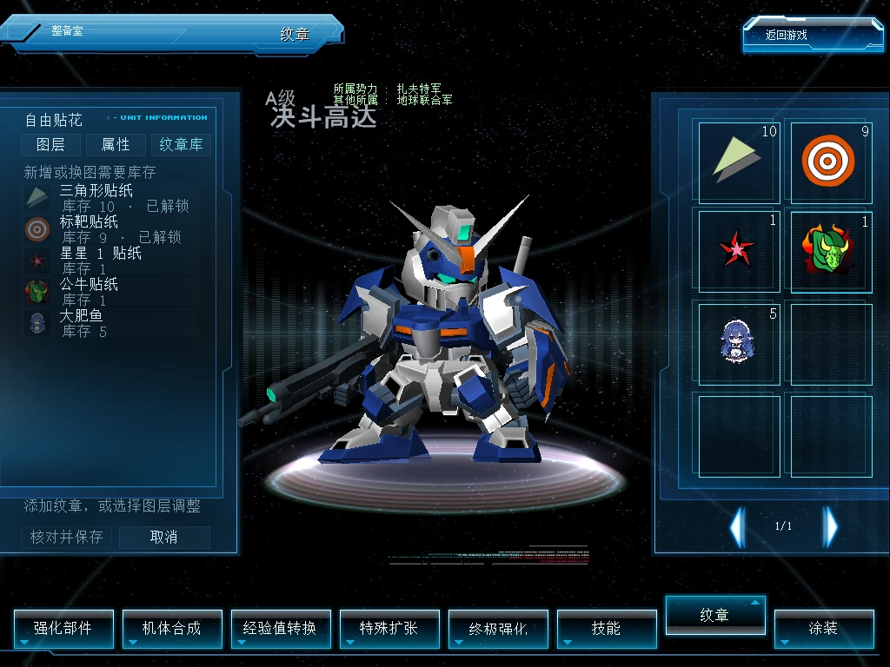

# 自定义贴纸导入



在 **Mod Manager → 服主工具 → 自定义贴纸** 中，把图片制作成游戏可读取的纹章。项目保存名称、透明图片和首次放置尺寸；生成的客户端资源与服务端定义成对使用。原版纹章保持原样。

“原版贴纸名称中文汉化”是独立开关，见[汉化说明](sticker-localization.zh-CN.md)。导入的名称由作者决定。

## 制作和应用

1. 新建项目，或选择内置的“大肥鱼”公开示例。
2. 填写名称，选择 Manager 中已添加的客户端与世界服务器。导入图片，检查透明边缘和人物比例。动画需要明确选择只保留第一帧。
3. 设置首次放置尺寸并保存。它控制自由贴花首次放到机体表面的大小，后续仍可在游戏中调整；制作预览的像素尺寸另行保存。
4. 运行原生预检。编译器检查目标客户端版本、编号、资源路径及服务端编号归属；原生客户端启动时还会核对内存目录中的冲突。
5. 关闭所选客户端后“安装到客户端”。核对“应用服务器定义”的变更范围，在服务组停止时确认应用，再正常重启并核对就绪。
6. 通过服主已有的库存、商城或奖励工具提供纹章，再在游戏工厂的纹章库中放置、预览并保存。默认消耗规则沿用[机体外观](unit-appearance.zh-CN.md)的设置。

导入器只登记定义，不自动发放物品、上架商品或更改价格。玩家通过**服主提供的客户端包或更新**取得相同内容；玩家更新器不执行数据库脚本。

## 图片与比例

界面按当前实际安装的解码器显示支持的格式，不根据文件扩展名假定图片有效。PNG、JPEG、BMP、GIF、WebP、TIFF、TGA、DDS、ICO、AVIF、HEIC/HEIF 等输入统一转换成有透明通道的 PNG。HEIC/HEIF 使用只含解码器的组件，并保持原生安全限制开启。具体可用项、文件大小和像素上限显示在导入页。

导入器也支持受限的自包含 SVG 基本形状。它先按节点、属性、路径和尺寸上限重新构造允许的路径及基本图形，再进行栅格化；XML 声明、实体、脚本、样式、文字与字体、嵌入图片、外部引用、资源 URL 及超出复杂度限制的内容均会被拒绝。

透明底会保留。已有白底不会仅凭颜色自动去除，以免误删白色衣服或标志；需要透明底时先准备带 alpha 的图片。原生材质统一为 512 × 512，保持图片比例并用透明区域补齐；缩略图复用同一材质。

盾牌示例宜使用较平整的面，保持适量边缘留白。中性盾牌轮廓是制作预览，游戏内最终效果由实际模型、位置、光照和贴花参数决定。

## 项目与协议

项目在 Manager 中独立保存，可新增、打开、修改和删除。删除项目不撤销已经安装的服务器定义，也不清除玩家库存。已安装项目再次应用时沿用原编号，保留其他项目；原版编号、其他项目编号和未登记作者修改均拒绝覆盖。

中立图片包使用 `sdgo.owner-stickers/1`。`owner.stickers.protocol` 提供创建、编码、解码和图片校验接口。例如，使用自己的透明 PNG：

```python
from pathlib import Path
from owner.stickers import images, protocol

canonical = images.canonicalize_raster(
    Path("roundel.png").read_bytes(), source_name="roundel.png"
)
entry = protocol.make_sticker(
    "training-roundel", "训练队徽", canonical,
    settings={"default_width": 2.0, "default_height": 2.0},
)
manifest = protocol.make_manifest([entry])
protocol.validate_payloads(
    manifest, {entry["image"]["path"]: canonical["png"]}
)
Path("manifest.json").write_bytes(protocol.encode_manifest(manifest))
```

图片路径固定为 `images/<id>.png`，并声明字节数、宽高及 SHA-256。清单禁止重复编号、重复路径和未知顶层字段；图片字节、摘要和尺寸必须相符。这个图片包是创作输入，不能直接复制到游戏目录当作原生资源。

Manager 原生项目使用 `sdgo.sticker-project/1`，包含独立的 32 位十六进制项目身份、宿主选择和图片描述。`owner.stickers.compiler.definition(project, image, native_id)` 将其验证为原生定义；`textures`、`compile_content` 与 `server_plan` 生成配套产物。原生名称最多 49 个 BMP 字符；编号由目标预检分配，已安装项目保持稳定。

## 原生编译契约

| 产物 | 用途 |
| --- | --- |
| `catalog.bin` | `SDGOST1` v1 目录，包含 kind 38 的 409 字节纹章、配套 kind 34 的 614 字节物品类别及独立的首次放置宽高 |
| `definitions.json` | 项目归属、纹章与物品类别编号、名称、源图片摘要及默认尺寸 |
| `resources.zdx` / `resources.zpk` | 经校验的缩略图和材质资源 |
| `resource-overlay.ini` | 绑定资源归档的 SHA-256 |
| `manifest.json` | 可随服主配置分发的内容摘要清单 |
| `server-plan.json` | 定义计划；不含凭据、库存或发放操作 |

原生库存和发放过程需要配套的第 17 类物品类别。其 `RefIndex` 指向纹章，缩略图引用同一个 SPR；登记类别不等于上架商品。服务器计划同时包含 `rows` 与 `categories`，发放工具使用类别编号。

当前普通纹章配置保留未限制等级、阵营及机体的固定布局，`StickerType=1`。原生行的名称在 `+5`、SPR 路径在 `+109`、材质路径在 `+209`；`+205` 的四字节保留为零，不能拿来存图片尺寸。首次放置尺寸来自目录扩展，避免向未证实的原生字段写入数据。

资源路径限定为 `sprs/sdgo_stickers_<编号>.spr` 与 `txrs/sdgo_stickers_<编号>.txr`，由共享资源 broker 的 `sticker_catalog` 域提供。`.txr` 中是客户端原生加载器可读取的 PNG；不改写原版归档。

服务端在一个事务中核对编号归属、更新固定定义和登记摘要，使用 ASCII 内部名称避免旧数据库字符集损坏中文。玩家看到的名称来自客户端 UTF-16 记录。

客户端安装使用跨进程目标锁、摘要回执和持久恢复日志。未完成安装可以重试恢复；发现其他作者修改则保留材料并拒绝覆盖。维护者修改共享内容后，应通过原有服主内容发布流程分发配套文件。
